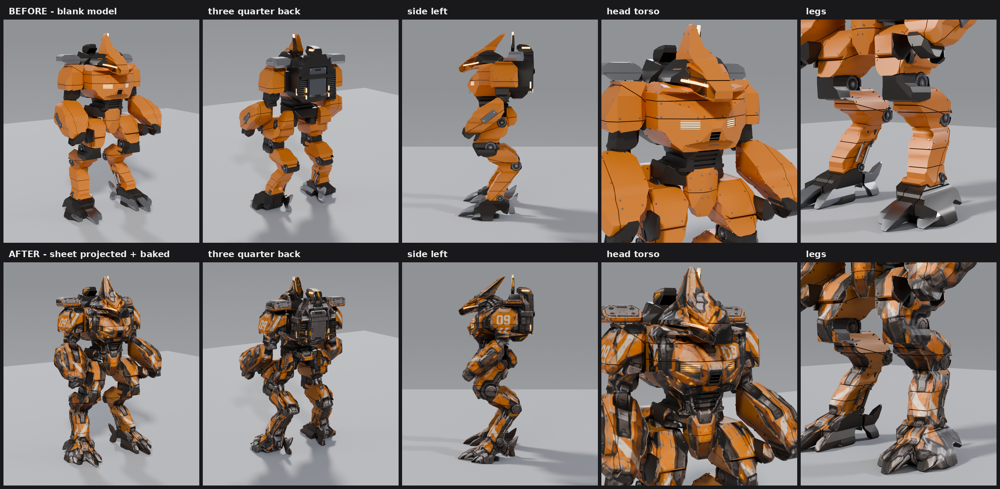

# Wraith (sheet 90) — fresh from-scratch build

A clean-room attempt at the **Wraith / Recon Support** mech, built only from
`90_Wraith_Recon-Support.png` in the *Ironhowl 3 – Mech Classes and Armaments
87-95* zip. No other model in this repo was opened or used as reference.

The workflow:

1. **Blank model:** a hard-surface 3D model that looks good on its own and
   matches the drawing's front, side and rear silhouettes as closely as possible.
2. **Skinned model:** the sheet's views are laid over that model and baked
   into a UV texture.

## Deliverables

| | Before (blank) | After (sheet projected + baked) |
|---|---|---|
| GLB (game-ready, Y-up, metres) | `models/wraith_blank_before.glb` (17 MB) | `models/wraith_projected_after.glb` (29 MB, 4096² JPEG embedded) |
| Blender | `blender/wraith_blank_before.blend` (non-destructive: mirror/bevel modifiers live) | `blender/wraith_projected_after.blend` (joined, UV'd, texture packed) |
| Triangles | **735,664** | **735,664** |
| Texture | – | `textures/wraith_projected_4096.png` (+ `_confidence.png`: white = taken from the sheet, black = filled) |

`viewer/index.html` is an interactive before/after viewer. It shows a synchronized orbit view,
plus Front, Side and Rear ortho views on the sheet's pixel grid with a reference-overlay slider.
Build its assets with `viewer/make_viewer_assets.sh`, then serve the folder over http.

Scale: 1 sheet pixel = 0.02 m, so the mech stands about 10.1 m tall. It faces −Y in
Blender (−Z in glTF), with its left side on +X.

## How close is it?

**Silhouette match of the blank model** (ortho renders on the sheet's exact pixel grid):

| view | IoU | notes |
|---|---|---|
| front | **0.952** | |
| side | **0.975** | |
| rear | 0.847 | The rear drawing doesn't agree with the front: wider leg stance, two ears instead of one crest + antenna. Front/side were prioritised. |

`renders/silhouette_diff_front_side_rear.png` shows grey where the model and sheet overlap, red where the
sheet has the mech but the model doesn't, and blue where the model sticks out.

**Colour match of the skinned model** (unlit render vs the sheet, inside the silhouette):

| view | mean abs error | pixels within 25/255 |
|---|---|---|
| front | 15.7 / 255 | 80.6 % |
| side | 16.1 / 255 | 81.1 % |
| rear | 26.4 / 255 | 61.8 % |

The `renders/reference_vs_model_{front,side,rear}.png` images show four columns:
the reference sheet, the blank model, the projected model unlit, and the projected model lit.

## How it was built

All of this is scripted in `scripts/` and runs headless through the `bpy` module (Blender 5.2.3 LTS).

1. **Silhouettes:** fit the sheet's grey background with a smooth surface,
   threshold the difference, and fill holes. This is done at 4× supersampling
   (`profiles.py`). The front symmetry axis was found by mirror-IoU (u = 518, mirror IoU 0.967).
2. **Part lassos:** `parts_spec.py` holds 29 hand-traced parts. Each has a
   front-view and a side-view polygon in sheet pixels. Each lasso is
   intersected with the silhouette, so only the inner boundaries between parts
   needed careful tracing (`renders/lasso_overlay_*.png`).
3. **Two-view prism intersection:** each part is
   `extrude(front profile, Y) ∩ extrude(side profile, X) ∩ top-view shaping`
   (V-front chest, chamfers, tapered snout). The front and side silhouettes are
   therefore exact by construction (`build_base.py`).
4. **Hard-surface pass:**
   - panel seams split the armour into plates, with a dark frame core visible in the gaps
   - weighted bevels, 6 segments on the primary edges
   - weighted normals
5. **Detail layer** (`details.py`): every detail is placed by ray-casting from
   the view where the sheet shows it. Most sit in pockets cut into the armour,
   so they don't change the silhouette:
   - recessed joint discs at hip, knee, ankle and foot
   - axles and metatarsus pistons
   - glowing chest vents, centre grille and abdomen ribs
   - snout eye-strip, forearm attachment interface and antenna glow
   - spine-dock back plate, vents and glow slits
   - holes in the shoulder mounting plates
   - neck and waist hoses
   - about 330 bolts
6. **Projection bake** (`prep_bake.py` + `project_bake.py`):
   - join everything and Smart-UV each part, weighting hidden parts lower, then pack with concave packing
   - bake per-texel world position and normal with Cycles
   - render position maps from the front, side, −X side and rear cameras for occlusion testing
   - for every texel, blend the views by `cos(normal, view)^12`, only where the depth test passes and the sample lands inside the drawn silhouette
   - **per-row silhouette warping:** match runs (arms, legs) between the model's and the sheet's silhouettes, so edge texels never sample background. This also absorbs the rear view's wider stance.
   - the −X half uses the mirrored side view, with the "09" decals flipped back so they read correctly
   - surfaces no view can see get the median sheet tone of their material, so they sit in the same tonal range
   - dilate into the UV gutters

Rebuild everything with `scripts/run_all.sh` (instructions inside).

## Does "model it clean, then project the image onto it" make sense?

Yes. This is the standard camera-projection and texture-bake workflow, and the closer the
geometry hugs the drawing, the better the bake. Things to know:

- **The three views aren't fully consistent with each other.** This is typical of concept sheets:
  - the rear has a wider stance and two ears
  - the shoulder pad sits ~10 px lower in the side view than in the front
  - the antenna height differs between views

  So one model can't be pixel-exact in every view at once. I matched front and side
  tightly and warp the rear image onto the model at bake time.
- **Three orthographic views can't see everything.** Top faces (shoulder tops,
  head top) and the insides of the legs are seen edge-on or not at all, so the
  bake stretches colour or falls back to the material tone. One more view would
  fix most of this: a clean 3/4 view, or a top view. The "Equipped" pose on the
  sheet is posed differently, so it can't be used.
- **Lighting is baked into the drawing.** The "after" albedo contains the
  concept's highlights and shadows, and engine lighting adds more on top.
  That's fine for a stylised look, or the texture can be de-lit later.
- **The sheet is low resolution** (the mech is about 515 px tall). The 4096² texture
  holds every source pixel several times over, but there is no extra detail to recover.
